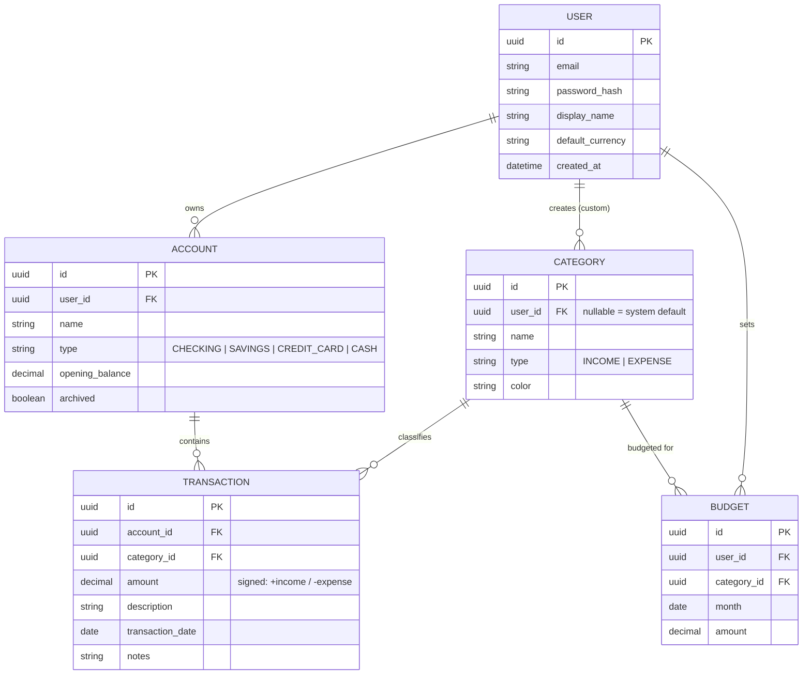

# Personal Finance & Budget Management Platform — Product Doc

## 1. What This Is

A web app that lets a user track their money across multiple accounts (bank, cash,
credit card, savings), categorize income/expenses, set monthly budgets per
category, and see a dashboard comparing actual spend vs. budget.

Goal: a clean, working, deployed MVP that demonstrates full-stack engineering
(API design, auth/authorization, relational data modeling, and a dashboard UI) —
built as a portfolio project, entirely on free tools/services.

---

## 2. Core Entities

### User
- `id`, `email` (unique), `password_hash`, `display_name`, `default_currency`, `created_at`

### Account
"Bucket" that money sits in.
- `id`, `user_id`, `name`, `type` (`CHECKING | SAVINGS | CREDIT_CARD | CASH`)
- `opening_balance`
- `current_balance` — **derived**, not stored: `opening_balance + Σ(transactions.amount)`.
  Avoids drift/reconciliation problems a stored running balance would introduce.
- `archived` (bool) — lets a user retire an account without deleting its transaction history

### Category
- `id`, `user_id` (nullable → null means a system default), `name`,
  `type` (`INCOME | EXPENSE`), `color`/`icon`
- No parent/child subcategories in v1 — adds modeling complexity (budget rollups) with
  no v1 payoff.
- ~10 system defaults seeded on registration: Groceries, Rent, Utilities, Dining,
  Transport, Entertainment, Shopping, Salary, Freelance, Other.

### Transaction
- `id`, `account_id`, `category_id`, `amount` (signed `NUMERIC(12,2)` — negative =
  expense, positive = income; never a float, to avoid rounding bugs), `description`,
  `transaction_date`, `notes`, `created_at`

### Budget
- `id`, `user_id`, `category_id`, `month` (first-of-month `DATE`), `amount`
- Unique constraint on `(user_id, category_id, month)`, enforced at the DB level.

**Relationships:** User 1—N Account 1—N Transaction N—1 Category; Budget N—1 User, N—1 Category (scoped by month).

### ER Diagram

*Note: VS Code mein "Markdown Preview Mermaid Support" extension install karo toh yeh diagram seedha preview mein dikhega. GitHub pe push karne ke baad automatically render ho jayega, koi extra setup nahi chahiye.*

---

## 3. User Stories — v1 (MVP Acceptance List)

1. Register with email + password (BCrypt-hashed; never logged or returned).
2. Log in and receive a token; every subsequent request is scoped to that user.
3. Create/edit/archive accounts I own — **cannot** see or touch another user's accounts.
   (This authorization rule must be airtight — test it explicitly, it repeats everywhere.)
4. See seeded default categories; add my own custom categories.
5. Add a transaction against one of my accounts + a category (amount, date, description).
6. Edit or delete a transaction.
7. List transactions filtered by account, category, and date range — paginated.
8. Set a budget amount for a category for a given month.
9. View a dashboard for the current month: total spent vs. total budgeted, a
   per-category bar (spent vs. budget), and a pie chart of spend by category.
10. Log out.

---

## 4. Explicitly Out of Scope for v1

- Bank sync (Plaid/Yodlee/Setu) — paid APIs; deliberately excluded
- Multi-currency conversion (currency is stored, never converted)
- Shared/household accounts
- Email/push notifications
- ML-based auto-categorization
- Recurring transaction automation
- CSV import
- Mobile app
- PDF/report export
- Audit trail / undo history

## 5. v2 / Stretch Features (pick 2–3 after MVP ships)

- Recurring transactions (scheduled job)
- CSV bank-statement import
- Budget alerts (email, free-tier provider)
- Rule-based auto-categorization (e.g. description contains "Zomato" → Food)
- Savings goals / debt payoff tracker
- Shared/household budgets (authorization-complexity showcase)
- Report export (PDF/CSV)

---

## 6. Tech Stack (100% free-tier, no paid APIs)

| Layer | Choice | Notes |
|---|---|---|
| Backend | Spring Boot 3.x, Java 21 | Spring Web, Spring Data JPA, Spring Security (JWT), Bean Validation |
| Database | PostgreSQL + Flyway migrations | Local via Docker Compose; hosted free tier (Neon/Supabase) for deploy |
| Frontend | React + Vite + **JavaScript** (no TypeScript) | Team preference — moves faster without the TS learning curve |
| Frontend state | React Query (or RTK Query) | Server-state caching |
| Styling | Tailwind + shadcn/ui (or MUI) | |
| Charts | Recharts | Dashboard: spend-vs-budget bars, category pie, monthly trend |
| Backend hosting | Render / Railway / Fly.io (free tier) | |
| Frontend hosting | Vercel / Netlify (free tier) | |
| CI | GitHub Actions | Run backend tests + frontend build on push |

**Rule of thumb on cost:** anything that talks to a real bank/payment/SMS provider
tends to be paid (Plaid, Setu, SendGrid at scale) — those are the excluded/deferred
features above. Everything else (auth, DB, hosting, charts, CI) is free at this scale.

Architecture: single Spring Boot monolith (controller → service → repository) — no
microservices; unjustified for a CRUD app at this scale.

---

## 7. Definition of Done (MVP)

A reviewer can open the deployed URL, log into a seeded demo account, see accounts/
transactions/budgets already populated, and the dashboard renders real spend-vs-budget
data — no empty states, no placeholder text.

---

## 8. Build Order

**Backend:** project skeleton + Docker Compose → Flyway migration → entities/repos →
auth (register/login/JWT) → Account CRUD → Category CRUD (+ default seeding) →
Transaction CRUD (+ filtering/pagination) → Budget CRUD + spend-vs-budget summary
service → global exception handler → tests.

**Frontend:** Vite/React scaffold + routing + API client → Login/Register + auth
context → Accounts page → Transactions page → Categories page → Budgets page →
Dashboard (charts).

**Polish:** seed/demo data → README (architecture diagram, screenshots, run
instructions) → deploy → CI.
